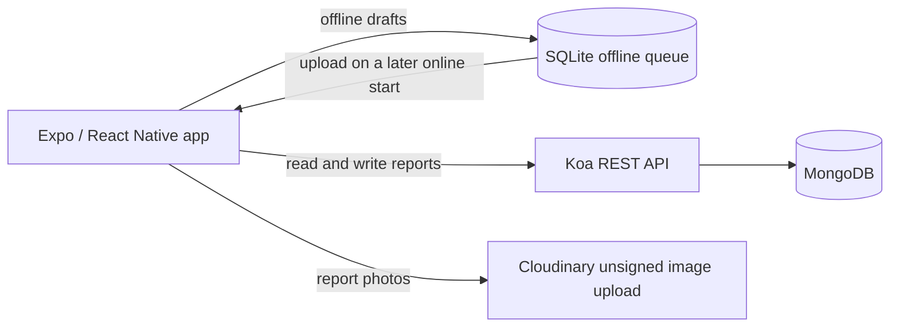

# Citizen Offense Reporting App

An Expo and React Native app for submitting community reports with a category, photo, and location. Reports can be browsed on a map or by date. The Koa and TypeScript API stores accounts and reports in MongoDB, while SQLite keeps a local queue for reports created offline.

> **Portfolio demo:** `backend/src/scripts/seedDemo.ts` creates clearly labeled synthetic reports in a local MongoDB database. They are fictional examples, not real incidents.

## Screenshots

No screenshots are included in this checkpoint. Android bundling is being checked separately; it does not verify that the app renders correctly on an emulator or phone.

## Features

- Email registration and sign-in with bcrypt password hashing and JWT authentication.
- Public map and calendar views of reports returned by the API.
- Report form with category, camera photo, and device location.
- Local SQLite queue when the API or network is unavailable; queued reports sync when the app starts online.
- Ukrainian and English text, light and dark themes, and a guest browsing flow.
- User profile reads and protected account routes.

## Architecture



The project is split into `frontend/` and `backend/`. The backend uses controllers, services, repositories, DTO validation, and Mongoose models. See [docs/api.md](docs/api.md) for the routes currently mounted by the server.

## Technology

| Area | Tools |
| --- | --- |
| Mobile | React Native, Expo SDK 54, React Navigation |
| Local storage | Expo SQLite, AsyncStorage |
| API | Node.js, Koa, TypeScript, Inversify |
| Database | MongoDB, Mongoose |
| Authentication | bcrypt, JSON Web Tokens |
| Images and location | Cloudinary unsigned upload preset, Expo Image Picker and Location |

## Run locally on Windows

### Requirements

- Node.js 20 or newer and npm.
- A local MongoDB service. The default connection is the isolated demo database `mongodb://127.0.0.1:27017/citizen_offense_demo`.
- Android Studio and an Android emulator, or Expo Go on a device.

### Start the API

In PowerShell:

```powershell
cd D:\GitHub-Portfolio\finalProject\backend
Copy-Item .env.example .env
npm ci
npm run seed:demo
npm run dev
```

The API listens on 127.0.0.1:3000 by default. The seed command accepts only a loopback MongoDB host and replaces only rows tagged by this demo script. The default database is separate from the project's earlier `backend_db_2` database. Set HOST=0.0.0.0 only behind a secured network boundary or TLS-terminating proxy.

For a stable local JWT across restarts, put a unique secret of at least 32 characters in `backend/.env`. Generate one in PowerShell with:

```powershell
[Convert]::ToHexString([Security.Cryptography.RandomNumberGenerator]::GetBytes(32))
```

The server creates a temporary random key if no `JWT_SECRET` is set in development. In production, it refuses to start unless a sufficiently long secret is configured.

### Start the mobile app

In a second PowerShell window:

```powershell
cd D:\GitHub-Portfolio\finalProject\frontend
Copy-Item .env.example .env
npm ci
npx expo start --android
```

The default API URL targets the Android Studio emulator. For a physical Android phone during development, use USB with adb reverse tcp:3000 tcp:3000 and http://127.0.0.1:3000. Release builds reject HTTP URLs; non-local deployments must use HTTPS.

Portfolio demo mode is enabled by default and disables live camera/location reporting. It uses only synthetic seeded reports. To opt into live reporting, set EXPO_PUBLIC_DEMO_MODE=false and configure Cloudinary public variables. These identifiers are visible in the app bundle; never put a Cloudinary API secret there. Restrict upload formats, size, destination, and quota before enabling a real account.

## Checks

Backend build, regression tests, and dependency checks:

```powershell
cd backend
npm ci
npm test
npm audit
```

`npm test` builds the TypeScript API and runs regression checks for bounded report pagination, cursor validation, and rejection of report-owner fields in PATCH requests. The app export and local demo API have also been verified with synthetic reports.

## API overview

The report list endpoint is public and paginated, with a server-side maximum of 100 results per page. Creating, editing, and deleting reports requires a bearer token. See [docs/api.md](docs/api.md) for request details.

## Security and project status

- Keep production secrets in the deployment environment; never commit `.env` files.
- The public report endpoint returns coarse coordinates and omits user IDs and image URLs. The report description is still public; define consent and moderation before storing real reports.
- The Cloudinary upload preset is public configuration, not a secret. Provider-side restrictions are required when live reporting is enabled.
- Local demo reports are synthetic and clearly labeled. Do not use this seed script with a remote database.
- No license is included in the repository; reuse and redistribution terms have not been specified.

This is a portfolio project and is not presented as a production-ready public safety service.
